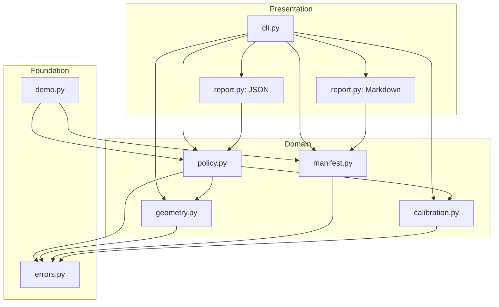

# Architecture

## Goals

1. **Deterministic decisions.** The same detections, manifest, and configuration must always produce the same verdict and report.
2. **No hidden dependencies.** The decision layer runs on Python 3.10+ with the standard library only.
3. **Auditability.** Every accepted finding and every ignored detection has a reason; every verdict is explainable from the report.
4. **Cross-platform agreement.** Geometry and manifest rules are explicit enough to be mirrored by the Rust/WASM preprocessor and JavaScript runtime.
5. **Research preservation.** Existing notebooks, Rust, ONNX, Flask/FastAPI samples, and assets remain unchanged.

## Layered design



Dependencies point downward only. `geometry` and `calibration` know nothing about inspection policy; `policy` knows nothing about argparse or files; `report` consumes plain result objects. This makes each module independently testable and lets a future HTTP service reuse the exact decision path.

## Request flow

1. **Load manifest** (`manifest.load_manifest`) — validate JSON shape, input tensor contract, labels, thresholds, platforms, calibration, metadata.
2. **Load detections** (`cli.load_detection_file`) — accept a list or an object with image dimensions; convert each item to a `Detection` with a validated `Box`.
3. **Manifest/label consistency** — every detection label must be declared by the manifest when one is supplied.
4. **Non-maximum suppression** (`geometry.non_max_suppression`) — drop scores below the manifest/score floor, then greedily suppress overlaps above the IoU threshold with deterministic tie-breaking.
5. **Calibration** (`calibration.TemperatureCalibrator`) — optionally rescale each class score. Monotonic, so detection ranking is unchanged.
6. **Policy** (`policy.InspectionPolicy.inspect`) — apply class severity and confidence floors, build findings with zone/area, compute aggregate risk, choose a verdict, and record reasons.
7. **Report** (`report.build_report`) — project the result into the versioned schema; render JSON or Markdown.

## Module responsibilities

| Module | Responsibility | Key invariants |
| --- | --- | --- |
| `geometry.py` | Box validation, clamping, IoU, NMS, letterbox | `x2 >= x1`, `y2 >= y1`; IoU in `[0, 1]`; NMS ties resolved by score then index |
| `manifest.py` | Model contract validation | No unknown keys; batch size 1; unique non-empty labels; `review < fail`; calibration labels must exist |
| `calibration.py` | Confidence math | Temperatures > 0; probabilities finite and in `[0, 1]`; calibrator is monotonic |
| `policy.py` | Findings and verdicts | Unknown classes fail closed; class rule severity wins; accepted findings bounded by `max_findings` |
| `report.py` | Schema and rendering | Required top-level keys; sorted JSON keys; Markdown derived only from the report dict |
| `cli.py` | I/O and argument handling | Domain errors return 2, never tracebacks; success returns 0 regardless of verdict |
| `demo.py` | Reproducible scenario | No file system, clock, or network access |

## Decision model

### Findings

A detection becomes a finding only if its calibrated confidence meets the class rule's `min_confidence`. Findings carry:

- class label and rule-derived severity (`minor`, `moderate`, `severe`);
- calibrated confidence and raw confidence;
- coarse zone (`front-left`, `middle-center`, `rear-right`, …);
- box coordinates and area ratio.

Detections below the floor are retained in `ignored` with a human-readable reason. Unknown labels raise `PolicyError` rather than being silently dropped.

### Aggregate risk

```text
risk = Σ severity_weight × calibrated_confidence
severity_weight: minor=1, moderate=2, severe=3
```

The verdict escalates to `fail` when:

- a `severe` finding meets its class `fail_confidence`, **or**
- aggregate risk reaches `fail_risk_threshold` (default `2.5`).

Otherwise it is `needs_review` when any finding is non-minor or meets its `review_confidence`; otherwise `pass`.

The two-path fail rule matters: a single high-confidence crack and several medium-confidence defects are different failure modes, and collapsing them into "max confidence" would miss the second.

## Geometry details

### Letterbox

```text
scale    = min(target_width / width, target_height / height)
new_w    = max(1, round(width  × scale))
new_h    = max(1, round(height × scale))
pad_x    = (target_width  − new_w) / 2
pad_y    = (target_height − new_h) / 2
```

Inverse mapping subtracts padding, divides by scale, and clamps to the original image. This is the math the Rust preprocessor and browser runtime must reproduce for boxes to land on the same pixels.

### NMS

Candidates are ordered by `(-score, index)`. A candidate is suppressed if IoU with any kept box is **strictly greater** than the threshold. Equal scores therefore have a stable, documented outcome instead of depending on sort internals.

## Report schema

Top-level keys:

| Key | Type | Meaning |
| --- | --- | --- |
| `schema_version` | string | `"1.0"` |
| `generated_at` | string or null | Injected UTC timestamp; null in pure library calls |
| `source` | string or null | Input file or `"demo"` |
| `model` | object or null | Manifest summary, including calibration map |
| `inspection` | object | Verdict, risk score, image dimensions |
| `findings` | array | Accepted defects with box, zone, confidence |
| `ignored` | array | Rejected detections with reasons |
| `suppressed_count` | integer | Detections removed by score floor/NMS |
| `reasons` | array | Human-readable decision rationale |

`report_to_json` sorts keys for stable diffs. `render_markdown` validates required keys before rendering.

## Cross-platform mapping

| Concern | Python package | Original research path |
| --- | --- | --- |
| Image resize / normalization | `geometry.letterbox`, manifest preprocessing | `src/lib.rs`, `src/*.ipynb` |
| Inference | not bundled (detector-agnostic) | `resnet18.onnx`, ONNX Runtime |
| Serving | CLI | Flask / FastAPI samples |
| Browser | — | `index.html`, ONNX Runtime Web |
| Decision policy | `policy.py` | not present in the original prototype |

The decision layer is deliberately runtime-independent: an ONNX server, a PyTorch batch job, and a WASM client can all emit the same detections JSON and receive the same verdict.

## Failure behavior

- Invalid geometry → `GeometryError`
- Invalid manifest/file read → `ManifestError`
- Invalid probability/calibration → `CalibrationError`
- Invalid detection/policy input → `PolicyError`
- Report construction/rendering failure → `ReportError`

All derive from `VehicleInspectionError`. The CLI catches that family and returns exit code `2` with `error: ...` on stderr.

## Non-goals

- Training or evaluating a vehicle-damage detector.
- Image decoding or tensor operations in the core package.
- Persistence, authentication, or multi-tenant serving.
- Regulated certification or legal inspection claims.
