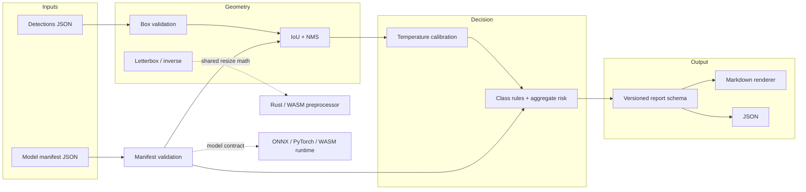

# Vehicle Inspection System — Cross-Platform Models

**A research prototype that learned to serve a model, then grew the part most demos skip: a deterministic, auditable decision layer that turns detections into an inspection verdict.**

[](https://github.com/MrKyaw/Vehicle-Inspection-System-Cross-Platform-Models-/actions/workflows/ci.yml)
[](https://www.python.org/)
[](TESTING.md)
[](License.text)

---

## The problem

A vehicle inspection model can detect a scratch, a dent, or a crack. That is not the same as answering the operational question:

> *Can this vehicle be released, does a human need to look at it, or should it fail inspection?*

Getting from bounding boxes to that answer requires agreement on geometry (what counts as the same detection?), model contracts (which input shape and labels is this artifact actually using?), calibrated confidence (is `0.72` trustworthy?), and an explicit safety policy (which defects escalate, and why?). Those are the parts that break when a notebook becomes a service.

This repository keeps the original cross-platform deployment research and adds a **stdlib-only Python package** that implements those decisions with tests, a CLI, and a stable report schema.

## What is demonstrated

- **Cross-platform deployment research** — PyTorch fine-tuning, ONNX export, ONNX Runtime inference, Flask/FastAPI serving, Rust → WebAssembly preprocessing, and ONNX Runtime Web in the browser.
- **Detection geometry** — validated boxes, IoU, deterministic NMS (explicit tie-breaking), clamping, aspect-preserving letterbox resize, and inverse mapping back to source pixels.
- **Model manifest validation** — strict parsing of input shape, labels, preprocessing, thresholds, platforms, calibration, and metadata. Unknown fields fail loudly.
- **Calibration and uncertainty** — per-class temperature scaling for detector scores, temperature scaling for probability vectors, expected calibration error, and confidence buckets, all in pure `math`.
- **Inspection policy** — per-class severity/confidence rules, ignored detections with reasons, aggregate-risk escalation, and three verdicts: `pass`, `needs_review`, `fail`.
- **Auditable output** — a versioned JSON schema plus a Markdown renderer projecting the same data for human review.
- **Operational CLI** — `python -m vehicle_inspection` with file input, optional manifest, `--demo`, `--json`, and `--output`.
- **Engineering rigor** — 372 tests, 100% line and branch coverage of the new package, CI across Python 3.10–3.12, and no network access in tests.

## Measured results

Verified locally with Python 3.12.8, pytest 9.1.1, and coverage 7.16.2:

```text
$ python3 -m pytest -q
372 passed

$ python3 -m pytest --cov=vehicle_inspection --cov-branch --cov-report=term-missing
Name                                Stmts   Miss Branch BrPart  Cover
vehicle_inspection/__init__.py         10      0      0      0   100%
vehicle_inspection/__main__.py          4      0      2      0   100%
vehicle_inspection/calibration.py     108      0     60      0   100%
vehicle_inspection/cli.py             136      0     46      0   100%
vehicle_inspection/demo.py             16      0      0      0   100%
vehicle_inspection/errors.py            7      0      0      0   100%
vehicle_inspection/geometry.py        103      0     40      0   100%
vehicle_inspection/manifest.py        215      0     88      0   100%
vehicle_inspection/policy.py          192      0    102      0   100%
vehicle_inspection/report.py           64      0     34      0   100%
TOTAL                                 855      0    372      0   100%
```

The coverage gate (`fail_under = 100`) is enforced in `pyproject.toml` and CI. See [TESTING.md](TESTING.md) for the test strategy.

## Architecture



The core is deliberately layered: geometry and calibration never import the policy; the policy never imports the CLI; the report consumes plain results. That keeps each layer independently testable and lets a future service reuse the exact same decisions.

## Repository map

```text
.
├── vehicle_inspection/          # New: dependency-free decision engine
│   ├── __init__.py              # Public API and version
│   ├── __main__.py              # python -m vehicle_inspection
│   ├── geometry.py              # Box, IoU, NMS, letterbox
│   ├── manifest.py              # Strict JSON model contracts
│   ├── calibration.py           # Temperature scaling, ECE, buckets
│   ├── policy.py                # Findings, severity, verdicts
│   ├── report.py                # Stable schema + Markdown
│   ├── demo.py                  # Built-in fail scenario
│   ├── cli.py                   # Argument parsing and file I/O
│   └── errors.py                # Custom exception hierarchy
├── tests/
│   └── test_vehicle_inspection.py
├── docs/
│   └── DESIGN_DECISIONS.md
├── examples/
│   ├── model_manifest.json
│   └── detections.json
├── src/                         # Preserved research artifacts
│   ├── fine_tune_pre_trained_model.ipynb
│   ├── model_conversion_web.ipynb
│   ├── model_deployment_rust_webassembly_web.ipynb
│   ├── model_deployment_onnx_flask_web.py
│   ├── model_deployment_onnx_fast_web.py
│   └── lib.rs
├── results/                     # Project screenshot from the original work
├── resnet18.onnx                # Exported model (optional to run)
├── index.html                   # Browser ONNX Runtime Web demo
├── Cargo.toml / Cargo.lock      # Rust/WASM preprocessor
├── pyproject.toml               # Packaging, pytest, coverage
├── Makefile
├── README.md / ABOUT.md / ARCHITECTURE.md / TESTING.md
├── CONTRIBUTING.md
├── .github/workflows/ci.yml
└── License.text                 # MIT
```

## Quickstart

No third-party dependencies are needed for the new package. From the repository root:

```bash
python3 -m vehicle_inspection --demo
```

Or install the console script and development tooling:

```bash
python3 -m pip install -e ".[dev]"
vehicle-inspection --demo
```

Run the tests:

```bash
python3 -m pytest -q
python3 -m pytest --cov=vehicle_inspection --cov-branch --cov-report=term-missing
```

## CLI examples

**Built-in demonstration** — includes a near-duplicate detection, a low-confidence detection, calibration, NMS, and aggregate-risk escalation:

```bash
python3 -m vehicle_inspection --demo
python3 -m vehicle_inspection --demo --json
```

The demo verdict is `fail` with:

```text
- **Verdict:** `fail`
- **Risk score:** 4.19
```

**Inspect a detections file with a model manifest:**

```bash
python3 -m vehicle_inspection examples/detections.json \
  --manifest examples/model_manifest.json \
  --image-width 1280 \
  --image-height 720
```

**Machine-readable output and report artifact:**

```bash
python3 -m vehicle_inspection examples/detections.json \
  --manifest examples/model_manifest.json \
  --json --output report.json
```

**Exit codes:** `0` for a completed inspection (any verdict), `2` for malformed input, invalid manifest, or I/O failure. The verdict is data, not process state, so a pipeline can store `needs_review` reports without treating them as crashes.

### Detections input

A bare array is accepted:

```json
[
  {"label": "scratch", "confidence": 0.82, "box": [120, 120, 300, 220]},
  {"label": "crack", "confidence": 0.71, "box": [300, 480, 360, 700], "severity": "severe"}
]
```

Or an object that carries image dimensions:

```json
{
  "image": {"width": 1280, "height": 720},
  "detections": [
    {"label": "dent", "confidence": 0.74, "box": [900, 380, 1100, 560]}
  ]
}
```

`box` is `[x1, y1, x2, y2]` in source pixels. `severity` is optional for input compatibility; the **policy rule for the class is authoritative**, so a detection cannot downgrade a severe class by claiming `"minor"`.

### Manifest example

```json
{
  "name": "vehicle-damage-resnet18",
  "version": "1.0.0",
  "input_shape": [1, 3, 640, 640],
  "labels": ["scratch", "dent", "crack", "chip"],
  "preprocessing": {
    "resize": [640, 640],
    "mean": [0.485, 0.456, 0.406],
    "std": [0.229, 0.224, 0.225],
    "pad_value": 114,
    "color_order": "rgb",
    "layout": "nchw"
  },
  "thresholds": {"score": 0.35, "iou": 0.5, "review": 0.6, "fail": 0.85},
  "platforms": ["onnx", "pytorch", "wasm"],
  "calibration": {"crack": 1.4, "dent": 1.2},
  "metadata": {"task": "vehicle-damage-detection", "license": "MIT"}
}
```

Validation rejects unknown keys, duplicate labels, unsupported platforms, non-positive dimensions, invalid color/layout values, calibration entries for undeclared labels, and `review >= fail`.

### Report output

The JSON report is versioned (`schema_version: "1.0"`) and stable:

```json
{
  "schema_version": "1.0",
  "generated_at": "2026-01-01T00:00:00+00:00",
  "source": "examples/detections.json",
  "model": {"name": "...", "version": "...", "platforms": ["onnx"], "calibration": {}},
  "inspection": {
    "verdict": "fail",
    "risk_score": 4.19,
    "image": {"width": 1280, "height": 720}
  },
  "findings": [
    {"label": "crack", "severity": "severe", "confidence": 0.655,
     "raw_confidence": 0.71, "zone": "rear-left",
     "box": {"x1": 300, "y1": 480, "x2": 360, "y2": 700},
     "area_ratio": 0.0143}
  ],
  "ignored": [],
  "suppressed_count": 1,
  "reasons": ["Aggregate risk 4.19 reached the fail threshold 2.50."]
}
```

Markdown is a projection of this document, so a dashboard and a human reviewer cannot disagree.

## Engineering decisions

- **Standard library only.** The decision layer must run in CI, on an air-gapped review machine, and inside a slim container. NumPy/PIL/ONNX Runtime are deployment concerns, not policy concerns.
- **Strict manifests.** An unknown key or duplicate label is a configuration bug. Silent tolerance is how pre-processing drift reaches production.
- **Deterministic NMS.** Sorting by `(-score, index)` makes equal-score behavior explicit and reproducible; suppression uses strict `IoU > threshold`.
- **Calibration cannot reorder detections.** Temperature scaling is monotonic. It changes absolute confidence and therefore policy decisions, but never which detection was strongest.
- **Aggregate risk, not max confidence.** Several medium-confidence defects can be worse than one high-confidence defect. `fail_risk_threshold` encodes that, and the reason string states the arithmetic.
- **Model contract vs. safety policy.** Manifest `score`/`iou` thresholds drive NMS; manifest `review`/`fail` values are validated and reported as export-time metadata. The CLI applies the per-class rules in `policy.py` because a severe crack and a cosmetic scratch must not share one threshold.
- **Injected clock.** The core `build_report` accepts `generated_at`; only the CLI reads the wall clock. Reports stay reproducible in tests.
- **Three verdicts, not two.** `needs_review` is a real operational state. Forcing a human decision into pass/fail hides uncertainty instead of surfacing it.
- **Additive preservation.** The notebooks, Rust crate, server samples, ONNX export, screenshot, and license remain untouched. The new package does not pretend the research model was trained on vehicle damage.

More detail: [ARCHITECTURE.md](ARCHITECTURE.md) and [docs/DESIGN_DECISIONS.md](docs/DESIGN_DECISIONS.md).

## Honest limitations

- **This is a research prototype, not a certified inspection system.** The original notebooks fine-tune ResNet models on **CIFAR-10** and demonstrate export/serving; they are not trained on a vehicle-damage dataset. The new package implements the *decision layer* a real detector would feed.
- **No detector inference is bundled in the tested path.** `resnet18.onnx` is a classification export from the research work. Running it requires optional dependencies (`onnxruntime`, `torch`, `torchvision`, `Pillow`), which are intentionally not required or exercised by the test suite.
- **The Flask/FastAPI samples require optional dependencies** (`flask`, `fastapi`, `uvicorn`) and paths to the ONNX model. The Rust/WASM path requires a Rust toolchain and `wasm-pack`. None are needed for the new package.
- **Zones are a coarse 3×3 image grid**, not panel segmentation. The research model predicts classes, not panels; finer labels would overstate the evidence.
- **Policy thresholds are engineering defaults**, not validated against a regulated inspection standard or a labelled fleet dataset.
- **Calibration temperatures in the demo are illustrative.** `TemperatureCalibrator` and ECE are implemented and tested, but no real calibration study is claimed.
- **The report schema is versioned but not yet consumed by an external service.** `1.0` is the first contract.

## Recruiter snapshot

If you have two minutes:

1. Run `python3 -m vehicle_inspection --demo` — see a defensible `fail` verdict with reasons, not just a class label.
2. Open `vehicle_inspection/policy.py` — class rules, ignored detections, aggregate escalation, and explicit verdict logic.
3. Open `tests/test_vehicle_inspection.py` — boundary cases, malformed manifests, NMS ties, letterbox extremes, calibration branches, and CLI failure paths.
4. Read `docs/DESIGN_DECISIONS.md` — trade-offs and what the system deliberately does not claim.

**Signals:** safety-oriented domain modeling, computer-vision geometry, strict input contracts, deterministic algorithms, 100% branch coverage, dependency hygiene, CI, and documentation that separates measured facts from aspirations.

## Author

**Kyaw Kyaw Oo**
- Email: [kyaw.tech@gmail.com](mailto:kyaw.tech@gmail.com)
- GitHub: [github.com/MrKyaw](https://github.com/MrKyaw)

## License

MIT — see [License.text](License.text). The original research artifacts retain their MIT license.
